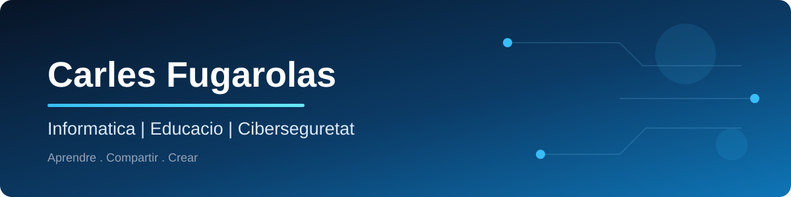

# Hola, soc en Carles Fugarolas 👋

  

## 💻 Sobre mi
Treballo com a **informàtic a l’Ajuntament de Cabrils** i com a **professor de formació professional a l’Escola Pia de Mataró**.
La meva curiositat per la tecnologia em porta a continuar aprenent: actualment curso un **grau en Ciberseguretat**.

## 🎯 Objectius del meu GitHub
Aquest espai està pensat per:
- Compartir **petits tutorials** i **píndoles formatives** relacionades amb la informàtica i la ciberseguretat.  
- Publicar **exemples pràctics** i **recursos docents** per a estudiants i professionals.  
- Explorar i compartir **bones pràctiques de seguretat informàtica**.

## 🧩 Interessos
- 💡 Ciberseguretat i privadesa digital  
- ⚙️ Sistemes operatius (Linux, Windows)  
- 🧠 Programació i automatització  
- ☁️ Tecnologies web i administració de sistemes Operatius

## 🛠️ Eines i tecnologies que faig servir

## 📚 Compartint coneixement
La meva idea és crear un espai obert i col·laboratiu on qualsevol pugui aprendre a través de continguts senzills, curts i pràctics.  
Si t’interessa el món de la ciberseguretat o l’educació tecnològica, t’animo a seguir els meus repositoris i participar-hi! 🚀  

---

> _"Aprendre, compartir i créixer és la millor forma d’entendre la tecnologia."_

